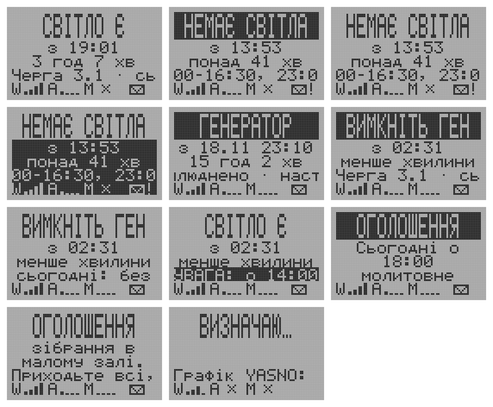

# Storozh svitla ("Power Watchman")

[Українська](README.md) · [Manual (Ukrainian)](docs/ІНСТРУКЦІЯ.md) · [Wiring diagrams (PDF, Ukrainian)](docs/СХЕМИ.pdf)

**Telegram notifications about mains power for any building with a TOMZN / eWeLink automatic transfer switch (ATS) —
without a single wire to the ATS.** An ESP32 becomes a separate Wi-Fi network for the ATS and knows whether mains power
is present from whether the ATS is on that network. Plus a generator, the YASNO outage schedule (Ukraine), a display,
an LED strip and sound. The user interface and documentation are in Ukrainian.

Built for a church in Ukraine: so people know whether there is power before they come, and the person in charge knows
when to start and stop the generator.

## How it works

The TOMZN TOQ7E ATS (eWeLink app) powers its Wi-Fi from the **mains** input only. Storozh — an ESP32 WROOM board —
joins the building's router and provides **its own** network just for the ATS, with NAT, so eWeLink keeps working.
ATS present on Storozh's network — mains is on; gone — mains is off. Delays (30 s / 10 s by default) filter out short
Wi-Fi drops, and messages carry the real moment of the event.

A **beacon** is an optional ESP32-C3 plugged into the generator's outlet: online means the generator is running.
Beacons on individual lines or phases report where voltage is present.

## Features

- **Telegram:** power lost / restored with durations and whether it matches the schedule; generator started, stopped,
  "turn it off" reminders; daily summary; up to 20 recipients (people and groups), each choosing what to receive and
  "quiet at night"; join requests with buttons; announcements from the admin to everyone. Undelivered messages wait in a
  queue that survives restarts.
- **Bot menu:** status, schedule, statistics, notification settings; for admins — users, log, device diagnostics,
  announcements.
- **YASNO outage schedule** (Dnipro — DnEM, CEK; Kyiv): warning N minutes before an outage, tomorrow's schedule and
  changes, emergency outages.
- **Statistics:** hours with and without power per day, week and month; recent outages.
- **Beacons** (up to 6): generator, line or phase, "display only".
- **Nokia 5110 display:** big status text, "off since 13:53 / 3 h 5 min already", the schedule as a scrolling line
  (adjustable speed), flashing and blinking on events, announcements; display and wiring self-test from the web page.
- **On-site signals:** two LEDs or a WS2812B strip (colours, effects, wave), a buzzer or a speaker via the DAC
  (built-in sounds or your own file), night quiet hours. Settings apply instantly.
- **Web settings page:** login, lockout after wrong passwords, wiring diagrams with the current pins, over-the-air
  updates with self-check and automatic rollback.
- **Reliability:** statistics, the Telegram queue, page logins and the current state with its start time survive
  restarts and updates (RTC memory); the device checks its own web page; it never writes flash on its own.

## Build and flash

Arduino-ESP32 **3.3.3** via `arduino-cli`, partition scheme `min_spiffs` (macOS scripts):

    tools/build.sh                 # both firmwares → build/
    tools/flash.sh mist --new      # first flash over USB (erases flash, adds the MAC to tools/devices.txt)
    tools/flash.sh mayak --new     # ESP32-C3 beacon

After that, update over the network from the device's page. First setup from a phone: Wi-Fi "AVR-mist-XXXX",
page http://10.77.0.1.

Host tests (macOS, clang): `tests/watch/run.sh`, `tests/lcd/run.sh`, `tests/yasno/run.sh`.

## License

[GPL-3.0](LICENSE). Code comments and documentation are in Ukrainian.
