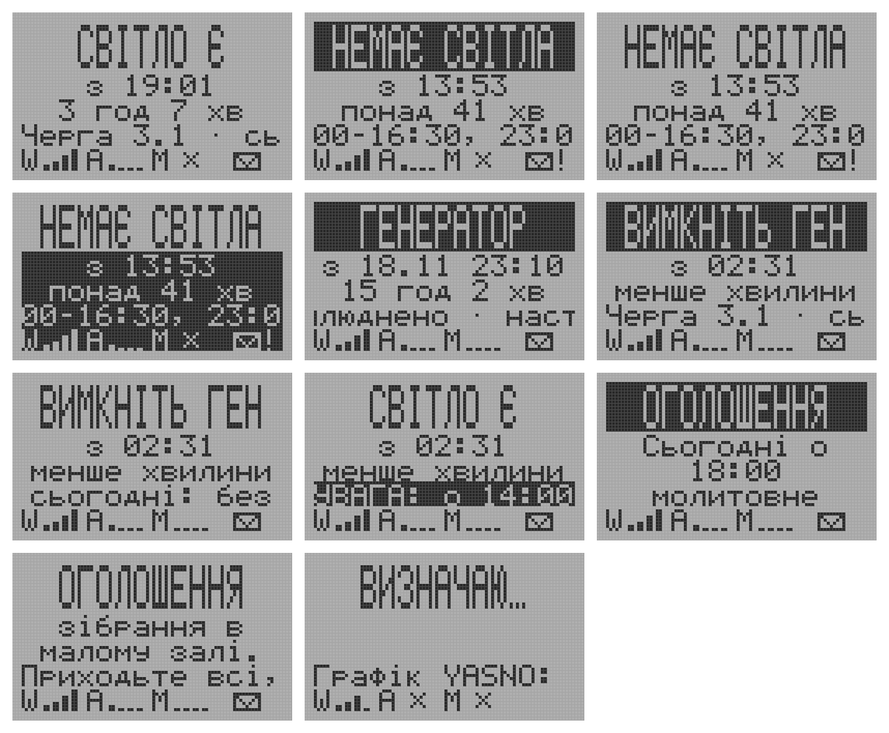

# Сторож світла

[English](README.en.md) · [Інструкція](docs/ІНСТРУКЦІЯ.md) · [Схеми підключення (PDF)](docs/СХЕМИ.pdf) ·
[Схеми мосту батареї (PDF)](docs/СХЕМИ-МОСТУ.pdf) ·
[Випуски — готові файли](https://github.com/roman885-85/storozh-svitla-esp32-power-outage-telegram/releases/latest)

**Сповіщення в Telegram, коли зникає й повертається міське світло, — для будь-якого приміщення, без жодного дроту до
електрощита.** Плата ESP32 роздає свою мережу Wi-Fi і знає, чи є світло, з того, чи на зв'язку свідок міста: автоматичний
ввід резерву (АВР) з Wi-Fi (TOMZN / eWeLink) чи **маячок** — найдешевша плата ESP (ESP8266, ESP32, ESP32-C3…) з
USB-зарядником у розетці, що живиться лише від міста. Тож підходить і АВР без Wi-Fi, і **ручний перемикач** «Місто — 0 —
Генератор»: тоді Сторож пише, коли й на що переключити. На вибір — генератор, окремі фази й лінії, батарея з JK BMS,
графік відключень YASNO, світло, звук і дисплей на місці. Інтерфейс і документація — українською.

## Для чого й де

| Де | Що дає |
|---|---|
| Офіс, магазин, склад, майстерня, кафе | чи працювати сьогодні; коли вмикати й вимикати генератор; чи не стоять без живлення холодильники |
| Школа, садочок, укриття, клуб, громадське приміщення | чи є світло перед заняттями чи зібранням; відповідальний знає про генератор |
| Багатоквартирний будинок (ОСББ), під'їзд, ліфт, насосна | мешканці знають, чи працюють ліфт і насос; попередження про відключення за графіком |
| Приватний будинок, дача | чи є світло, поки вас немає; заряд батареї інвертора |
| Котельня, серверна, ферма | напруга на важливих лініях і фазах, генератор, батарея |

Що можна стерегти:

- **Міське світло** — головне: Сторож і маячок «Міське світло» в розетці лише від міста **або** АВР TOMZN TOQ7E з
  Wi-Fi (чи інший пристрій Wi-Fi, що живиться лише від міста: розумна розетка, реле). Разом — надійніше: зависання Wi-Fi
  АВР не дасть хибного «Зникло».
- **Генератор** — маячок у розетці на виході генератора: «працює», «зупинився», «вимкніть — місто вже є».
- **Ручний перемикач** «Місто — 0 — Генератор» чи рубильник: «запустіть генератор і переключіть на «Генератор»»,
  «переключіть на «Місто» і вимкніть генератор»; з маячком лінії після перемикача — нагадування, доки не переключать.
- **Фази й окремі лінії** — маячок у розетці кожної фази чи лінії: на трифазному вводі АВР бачить лише свою фазу.
- **Батарея й інвертор** — батарея з JK BMS і міст батареї ESP32-C3: заряд, на скільки вистачить, тривоги BMS; до 4 BMS
  на один міст (по черзі), світло й звук прямо біля батареї.
- **Графік відключень YASNO** (Дніпро — ДнЕМ і ЦЕК, Київ — ДТЕК): попередження перед відключенням, графік на завтра.
- **Сигнали на місці** — стрічка чи світлодіоди, бузер чи динамік, дисплей Nokia 5110.
- **Облік** — скільки світло було й не було за день, тиждень, місяць; щоденний підсумок.

Кілька приміщень — по Сторожу на кожне, у кожного свій бот.

## Як це працює

Сторож світла — плата ESP32 WROOM — під'єднується до роутера приміщення й роздає **свою** мережу для АВР і маячків, з
NAT: застосунок eWeLink працює як раніше. **Маячок** — найпростіша плата ESP у розетці: кожні 2 с каже Сторожу «я тут»,
мовчить — у розетці немає напруги. АВР TOMZN TOQ7E живить свій Wi-Fi лише від **міського** вводу, маячок «Міське
світло» стоїть у розетці лише від міста. Тож правило одне: свідок міста на зв'язку — світло є; 12 с мовчить — світла
немає; знову 10 с на зв'язку — є. Без здогадок, а час у повідомленні — справжній момент події.

Маячки — ESP8266 (Wemos D1 mini, NodeMCU, ESP-01S), ESP32, ESP32-C3, S2, S3, C6: програма одна, файл — для свого чипа.

| Місто (АВР чи маячок міста) | Маячок генератора | Що це означає |
|---|---|---|
| є | немає | міське світло є, генератор стоїть |
| немає | є | міста немає, працює генератор |
| немає | немає | немає ні міста, ні генератора |
| є | є | місто повернулось, а генератор ще працює — Сторож нагадає вимкнути |

**Міст батареї** — необов'язкова плата ESP32-C3 біля батареї з **JK BMS**: тримає з BMS постійне з'єднання по Bluetooth
(або опитує до 4 BMS по черзі раз на 1–30 хв — тоді кожна пищить раз на період) і кожні 5 с передає Сторожу заряд,
напругу, струм, комірки, температури й тривоги. Сторож до BMS не під'єднується й нічого їй не пише.

## Як почати

1. Завантажити з [випусків](https://github.com/roman885-85/storozh-svitla-esp32-power-outage-telegram/releases/latest) `avr-mist-<версія>-full.bin`
   і прошити ним плату ESP32 WROOM — у браузері ([esptool-js](https://espressif.github.io/esptool-js/), адреса `0x0`)
   чи `esptool.py --chip esp32 write_flash 0x0 avr-mist-<версія>-full.bin`.
2. Живити Сторожа від ДБЖ роутера. Телефоном під'єднатись до мережі «AVR-mist-XXXX» (пароль — «avr» і вісім останніх
   знаків MAC-адреси плати), відкрити http://10.77.0.1, користувач admin.
3. «Налаштування»: назва об'єкта й значок для повідомлень, Wi-Fi роутера, свої паролі сторінки й точки — «Зберегти». У роутері закріпити за
   Сторожем постійну адресу.
4. Місто: АВР з Wi-Fi — коли є світло, підключити його в eWeLink до мережі «AVR-mist-XXXX» і на сторінці (картка
   «Пристрої») натиснути «Це АВР»; без нього — маячок «Міське світло». Ручний перемикач — «Налаштування → АВР чи
   перемикач» → «Вручну».
5. Створити бота в @BotFather, вставити токен на вкладці «Сповіщення», додати себе й інших.
6. За бажанням — маячки, графік YASNO, сигнали, дисплей, батарея.

Покроково, з усіма налаштуваннями — [інструкція](docs/ІНСТРУКЦІЯ.md).

## Можливості

- **Telegram:** «🔴 Зникло міське світло» / «🟢 Повернулось» — з тривалістю й тим, чи за графіком; генератор
  (запустився, зупинився, «вимкніть»); щоденний підсумок; до 20 одержувачів (люди й групи), кожному — що надсилати й
  «уночі без звуку»; заявки нових людей кнопками; оголошення від адміністратора всім. Повідомлення, що не пішли
  (немає інтернету), чекають у черзі й переживають перезапуск.
- **Меню бота:** «📊 Стан», «🗓 Графік», «📈 Статистика», «🔔 Сповіщення»; адміністраторам — «👥 Користувачі»,
  «📋 Журнал», «🛠 Сторож» (прошивка, пам'ять, сигнали, маячки, міст батареї), «📣 Оголошення».
- **Графік відключень YASNO:** попередження за N хв до відключення, графік на завтра й зміни, аварійні відключення; у
  повідомленнях — за графіком відключення чи ні.
- **Статистика:** скільки світло було й не було за день, тиждень, місяць, останні відключення.
- **Маячки** (до 6): генератор, лінія чи фаза, «лише показувати»; повідомлення «🔌» про лінії.
- **Батарея (JK BMS)** через міст батареї: картка «🔋 Батарея»; у Telegram — заряд нижче 50/30/20/10 % і «вистачить
  менше ніж на 3 год / на годину», коли міста немає; «BMS повідомляє …» (тривоги BMS); «BMS не на зв'язку».
  Кілька BMS (до 4) — по черзі, кожна батарея окремо («Батарея 2 «Гараж»: заряд 30 %»). На мості — світло (два
  світлодіоди чи стрічка WS2812B) і звук (активний чи пасивний бузер: зарядилась, 50/30/20/10/5 %, повний розряд,
  тривога BMS та інші; важливе повторюється, ніч, тиша кнопкою), дисплей Open-Smart 1,8″ ST7567 (128×64); у картках
  сторінки мосту — вільні виводи плати й схеми підключення з вибраними номерами. Сторінка мосту
  відкривається зі сторінки Сторожа; прошивку мосту можна поставити **файлом через сторінку Сторожа** (Сторож сам
  передає її мосту по своїй мережі) чи за адресою файлу (http/https), з відкатом.
- **Кнопки перезапуску** Сторожа й мосту — у картці «Пристрої» й на вкладці «Оновлення»; маячка — на його сторінці.
- **Пристрої:** чіткий список — що прив'язано до Сторожа (роутер, АВР, маячки, міст батареї) і чи воно зараз на
  зв'язку, а нижче — інші пристрої в його мережі з тим, що це (маячок не зі списку, телефон, невідомий — може бути АВР),
  і кнопками «Додати маячок» / «Це АВР».
- **Дисплей Nokia 5110:** стан великими літерами, «немає з 13:53 / вже 3 год 5 хв», графік біжучим рядком, спалахи й
  миготіння на подіях, оголошення; перевірка дисплея й дротів зі сторінки.
- **Сигнали на місці:** два світлодіоди чи адресна стрічка WS2812B (кольори, ефекти, хвиля), бузер чи динамік через ЦАП
  (вбудовані звуки або свій файл). Уночі світлодіоди, стрічка й підсвітка дисплея гаснуть (або тьмяніють), звук — за
  бажанням. Налаштування діють одразу, без «Зберегти».
- **Сторінка налаштувань** (українською): вхід формою, паузи після хибних паролів, схеми підключення з поточними
  виводами, оновлення прошивки по мережі з перевіркою й автоматичним відкатом.
- **Надійність:** облік, черга Telegram, входи на сторінку, стан і «відколи» переживають перезапуск і оновлення; після
  перезапуску стан — одразу. Недоступний інтернет чи Telegram прилад не перезапускає: повідомлення чекають у черзі й
  ідуть, щойно Telegram відповів, — з позначкою запізнення й без дублів. Сам себе перезапускає лише коли справді завис —
  і записує причину в «чорну скриньку» разом з останніми рядками журналу; після збою зі сторінки можна завантажити дамп.
  Браузер, що не приймає відповідь сторінки, не тримає Сторожа. Пам'ять для шифрування відкладено при запуску, з
  Telegram — одне довге з'єднання; сторінка показує справжню вільну пам'ять. У флеш прилад сам нічого не пише — лише дії
  людини (і дамп, який при збої записує ESP-IDF).

## Що потрібно

- Плата **ESP32 WROOM** (DevKit V1, 30 виводів) і USB-блок 5 В — **від ДБЖ** роутера: Сторож має працювати й без світла.
- Маячок «Міське світло» (будь-яка плата ESP і USB-зарядник) **або** АВР **TOMZN TOQ7E** (eWeLink) чи інший пристрій
  Wi-Fi, що живиться лише від міста й відповідає на ping.
- Роутер з інтернетом (Wi-Fi 2,4 ГГц) і Telegram-бот (токен від @BotFather — покроково на сторінці Сторожа).
- Необов'язково: маячки — **ESP8266** (D1 mini, NodeMCU, ESP-01S), **ESP32**, **ESP32-C3**, S2, S3, C6; **ESP32-C3** для
  мосту батареї (батарея з **JK BMS** з Bluetooth; дисплей мосту —
  Open-Smart 1,8″ ST7567); дисплей **Nokia 5110** (PCD8544, 3,3 В); стрічка **WS2812B** чи два світлодіоди;
  активний/пасивний бузер чи динамік із підсилювачем **PAM8403**; кнопка скидання пароля.

Як підключати — [docs/СХЕМИ.pdf](docs/СХЕМИ.pdf) (ті самі схеми є на вкладці «Інструкція» самої сторінки — з виводами,
як їх задано зараз); міст батареї — [docs/СХЕМИ-МОСТУ.pdf](docs/СХЕМИ-МОСТУ.pdf) (і в картках «Світло», «Звук»,
«Дисплей» сторінки мосту — з вибраними виводами). Повна інструкція — [docs/ІНСТРУКЦІЯ.md](docs/ІНСТРУКЦІЯ.md).

## Збірка й прошивка зі сирців

На будь-якій системі — **Windows, Linux, macOS**: потрібні Python 3.8+ і
[`arduino-cli`](https://arduino.github.io/arduino-cli/latest/installation/); ядра Arduino-ESP32 **3.3.3** (схема
розділів `min_spiffs`) і ESP8266 **3.1.2** скрипт поставить сам, esptool приходить разом з ними.

    python3 tools/build.py --setup        # один раз: ядра esp32 3.3.3 і esp8266 3.1.2
    python3 tools/build.py                # усі прошивки → build/ (Сторож, маячок, міст батареї; чи окремо: mist, mayak, bms)
    python3 -m pip install pyserial       # для прошивки кабелем
    python3 tools/flash.py mist --new     # перша прошивка Сторожа (стирає флеш, вносить MAC у tools/devices.txt)
    python3 tools/flash.py mayak --new    # маячок: ESP8266, ESP32, C3, S2, S3, C6 — образ за чипом
    python3 tools/flash.py bms --new      # міст батареї ESP32-C3

У Windows — `py tools\build.py`, `py tools\flash.py …`. Порт скрипт знаходить сам (COM…, /dev/ttyUSB…, /dev/cu.…), кілька
плат — `--port`. `tools/build.sh` і `tools/flash.sh` — те саме для Linux і macOS.

Далі — по мережі: сторінка Сторожа → «Оновлення» → `avr-mist-<версія>-app.bin`. Нова версія запускається
«на перевірці»: сторінка не відповіла чи Wi-Fi не запрацював за 3 хв — Сторож сам повертається на попередню.
Міст батареї — зі сторінки Сторожа: «Оновлення» → «Оновлення мосту батареї», файл `avr-bms-<версія>-usb-app.bin` (Сторож
1.0.48+); або зі сторінки мосту за адресою файлу (міст 1.1.0+).

## Перевірки на комп'ютері

C++ (clang чи g++) і Node.js; картинки сторінок робить Chrome без вікна (шлях у `run.sh` — як у macOS, для іншої системи
поправте його).

    tests/watch/run.sh             # маячки, лінії, генератор, перезапуски — справжній watch.cpp з підставними мережею й Telegram
    tests/lcd/run.sh               # кадри дисплея (tests/lcd/out/*.png), тексти й тривалості
    tests/yasno/run.sh             # розбір відповіді YASNO
    tests/bms/run.sh               # протокол JK BMS (кадри 24S і 32S), вибір BMS
    tests/bat/run.sh               # сповіщення про батарею — справжній bms.cpp
    tests/batlcd/run.sh            # кадри дисплея мосту (tests/batlcd/out/*.png) і потік байтів драйвера ST7567
    tests/logring/run.sh           # журнал у пам'яті команд (32-бітне кільце)
    tests/webguard/run.sh          # відлік часу відповіді сторінки
    tests/devices/run.sh           # картки «Пристрої» й «Батарея» з page.cpp — картинки 780 і 360 px
    tests/batev/run.sh             # події батареї для світла й звуку мосту (зарядилась, 50…5 %, тривога, перекіс…)
    tests/alert/run.sh             # мелодії, шаблони бузера, кадри світлодіодів і стрічки
    tests/bmspage/run.sh           # сторінка мосту на підставних даних — картинка

## Тека

| Шлях | Що там |
|---|---|
| `firmware/avr-mist/` | прошивка Сторожа (ESP32 WROOM) |
| `firmware/avr-mayak/` | прошивка маячка (ESP8266, ESP32, ESP32-C3, S2, S3, C6) |
| `firmware/avr-bms/` | прошивка мосту батареї JK BMS (ESP32-C3) |
| `docs/` | інструкція й схеми |
| `tests/` | перевірки на комп'ютері |
| `tools/` | збірка, прошивка, шрифт дисплея, PDF |

## Ліцензія

[GPL-3.0](LICENSE). Коментарі в коді й документація — українською.
